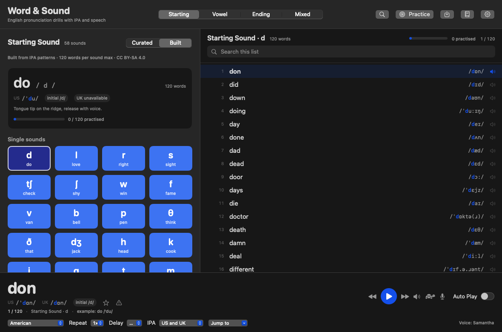
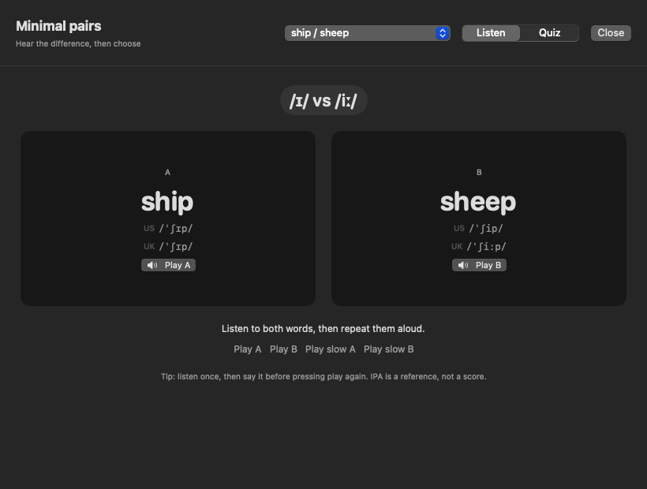
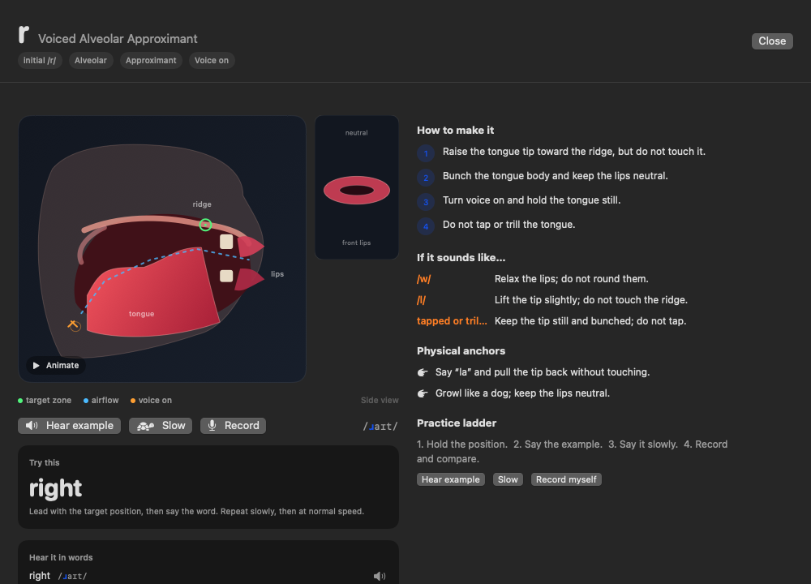
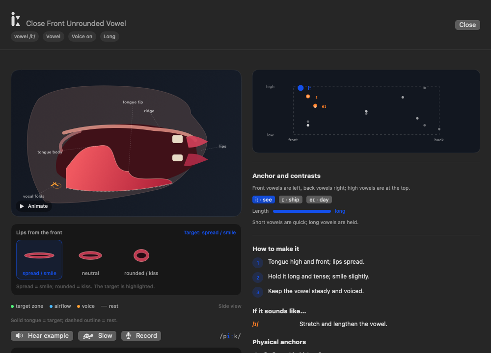
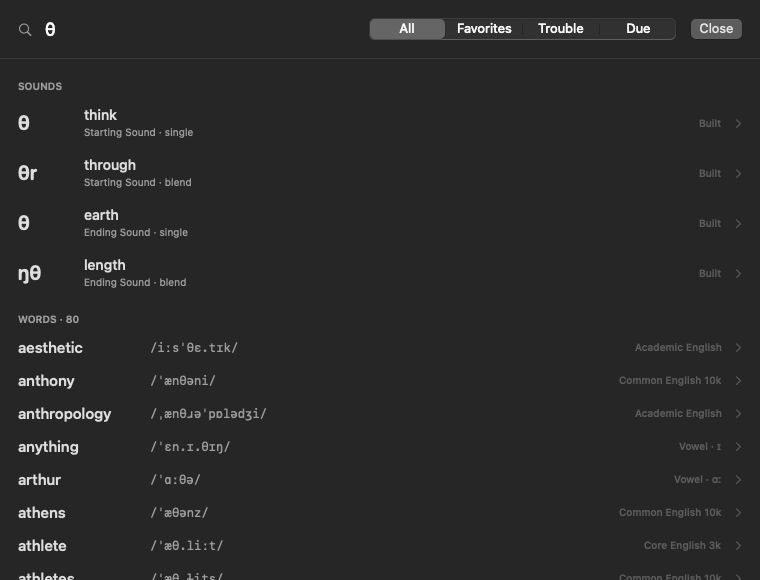

# Word & Sound (macOS)

[](https://github.com/somphol/word-and-sound/actions/workflows/ci.yml)

A native macOS pronunciation trainer and a matching React web app, both built
from the MIT App Inventor project `WordAndSound.aia`. They keep the original's
five ways of working on a sound — starting sounds, starting blends, ending
sounds, ending blends and vowels — and replace the restricted vocabulary with
openly licensed data.

The macOS app is the primary build. The web app is a full-parity PWA at
**https://somphol.github.io/word-and-sound/**; it loads the same JSON and
works offline after the first visit. The repository was renamed from
`word-and-sound-mac`; GitHub redirects the old repository and release links.











## What it does

- **134 sound tiles** across starting sounds, starting blends, ending sounds,
  ending blends and vowels.
- **Curated / Built switch.** *Curated* is the author's original 60 lists.
  *Built* selects words from open IPA data by onset, coda or vowel pattern,
  ranked by frequency, up to 120 words per sound.
- **US and UK IPA**, displayed together when available, with the target
  segment highlighted and a short articulatory tip.
- **Animated articulation coach**: 48 phoneme guides with a side-view mouth,
  tongue/lip steps, contact points, common errors and physical anchors.
  Especially detailed for /r/ and /s/; blends show their component sounds.
- **Vowel space and lip comparison**: every vowel shows a high/low ×
  front/back chart, a spread/neutral/rounded lip comparison, an anchor word,
  contrast vowels, and a short/long/glide meter.
- **Labelled side view**: tongue tip, tongue body, ridge, lips and vocal folds;
  a dashed rest position and an arrow show the movement to the target.
- **37 minimal pairs** with listen and quiz modes for the contrasts ESL
  learners need most.
- **Global search (⌘K)** across every sound, list and word, with IPA search;
  the last word in each list is remembered.
- **Favorites, trouble words and a review queue** with local spaced review.
- **Record and compare**: hear the model, record yourself, replay both. No
  automatic score; recordings stay on the Mac.
- **Autoplay** with repeat count, delay, five accents (US, UK, Australian,
  Indian, Irish), rate and pitch.
- **Four mixed vocabulary lists** — Core English 3k, Everyday Spoken,
  Academic English and Common English 10k — plus a local **Review** list built
  from favorites, trouble words and due items.
- **Import** your own `.txt` or `.csv` word list. Imported lists stay on the
  Mac.
- Keyboard: Space play/pause, ⌘R replay, ⌘←/⌘→ previous/next word.

## Build and run

Requirements: macOS 14 or later, Xcode command-line tools, Python 3.
CI runs the core/data tests on Linux; the SwiftUI app is built locally with
`make app`.

```bash
make check          # unit tests + headless self-test
make app            # build/WordAndSound.app (release, ad-hoc signed)
make run            # build and open the app
```

[Download the latest release](https://github.com/somphol/word-and-sound/releases/latest)
for a prebuilt app (ad-hoc signed, not notarized).

The app is not notarized. On first launch from a downloaded copy, right-click
the app and choose **Open**.

## Web app

The React + TypeScript app in `web/` mirrors the macOS feature set: 134 tiles,
Curated/Built sources, US/UK IPA with target highlighting, autoplay, the
articulation coach, vowel space and lip comparison, minimal pairs, search,
favorites/trouble, spaced review, import, recording and credits.

```bash
./scripts/sync-web-data.sh   # copy data/*.json and the icon into web/public/
make web                     # npm ci + tests + production build
make web-dev                 # Vite dev server on http://127.0.0.1:5173/
cd web && npm run preview    # serve the production build on :4173
```

`make web` and the GitHub Actions workflows run `npm ci`, so keep
`web/package-lock.json` committed. Tests are Vitest (`web/src/lib/*.test.ts`).
The production build is a static `web/dist/` directory with a service worker
and a web app manifest; there is no backend and no analytics. Keyboard:
Space plays the current word, ⌘/Ctrl+R replays it, ⌘/Ctrl+←/→ step through the
list and ⌘/Ctrl+K opens search.

## Data pipeline

The generated JSON is committed under `data/`. To rebuild it:

```bash
python3 tools/fetch_corpus.py --kaikki   # downloads sources to data/sources/
make data                                # extract, merge, build pattern lists
make check
```

`make data` expects the original project at `~/Downloads/WordAndSound.aia` and
the Kaikki dump at `/tmp/kaikki_en.jsonl.gz` by default. Override the dump with
`make data KAIAKI=/path/to/kaikki_en.jsonl.gz`.

Pipeline:

1. `tools/extract_aia.py` reads the `.aia`, extracts the 60 authored lists and
   tile metadata, and discards the bundled IPA tables.
2. `tools/build_corpus.py` adds the NGSL/NAWL/NGSL-S/FrequencyWords lists and
   builds US/UK IPA dictionaries from ipa-dict and Kaikki.
3. `tools/build_pattern_lists.py` generates onset, coda, blend and vowel lists.

## Numbers

| Item | Count |
|---|---|
| Sound tiles | 134 |
| Starting sounds | 58 (23 single + 35 blends) |
| Ending sounds | 53 (20 single + 33 blends) |
| Vowels | 23 |
| Authored words | 15,326 |
| Pattern-built words | 11,768 |
| Mixed-list words | 14,484 |
| US IPA entries | 39,886 |
| UK IPA entries | 22,072 |
| Tile-list IPA coverage | 96.8% US, 89.3% UK |
| Articulation guides | 48 (47 used by tiles) |
| Vowel anchor words | 24 |
| Minimal pairs | 37 |
| Review intervals | 1, 3, 7, 14, 30 days |

## Project layout

```
Sources/WordAndSoundCore/     models, data loader, sequencer, parser, self-test
Sources/WordAndSound/         SwiftUI app, speech engine, views
Resources/                    generated JSON, provenance, icon
web/                          React PWA sharing data/ through web/public/data/
tools/                        extraction and corpus builders
scripts/make_app.sh           release bundle + ad-hoc signing
Tests/                        XCTest coverage of core logic
data/                         generated data and provenance
licenses/                     third-party notices and license texts
```

## Documentation

- GitHub: https://github.com/somphol/word-and-sound
- `AGENTS.md` — architecture, commands, constraints and handoff notes
- `LICENSES.md` — code and data licensing
- `CONTRIBUTING.md` — how to propose changes safely
- `docs/RELEASE.md` — release checklist and artifact steps
- `CHANGELOG.md` — release history

## Licenses

Code is MIT (root `LICENSE`). Bundled data is CC BY-SA 4.0. See `LICENSES.md`
and `licenses/DATA-NOTICES.md`. Imported lists are the user's responsibility.

The project is not affiliated with Oxford University Press, ETS, EF, or the
publishers of the original vocabulary lists. Those lists are not shipped.

## Known issues

- UK IPA is intentionally conservative: words with several competing British
  forms are left to the US fallback. About 14% of the authored lists fall back.
- Pattern-built lists are frequency-ranked and can include inflected forms and
  proper names; they are drills, not a dictionary.
- Rare clusters have short lists: `ʒ` onset has 3 words, `ŋθ` and `ʒd` have 3
  each, `mf` has 4. Rhotic coda clusters (`rd`, `rk`, `rt`, …) are omitted
  because the tile inventory is non-rhotic RP; US rhotic vowels are still shown
  in the IPA line.
- The app is unsigned/not notarized and is not distributed through the App
  Store (the CC BY-SA data must remain extractable).
- Voice quality depends on the macOS voices installed. Missing voices are
  reported in the player bar.
- Recording needs the bundled app (not `swift run`) for the microphone usage
  description. Recordings and review history are local and deletable.
- Minimal pairs and review are practice aids, not an automatic pronunciation
  score.
- The web app speaks through the browser's Web Speech API. Voice availability,
  accent coverage and quality depend on the browser and OS; headless browsers
  usually report no English voice.
- Web recordings are held in memory for the current dialog and are discarded
  on close. Nothing is uploaded. Safari's MediaRecorder support differs from
  Chrome's.
- The PWA caches the shell and JSON after the first online visit. A hard
  reload is required to pick up a new deployment.
